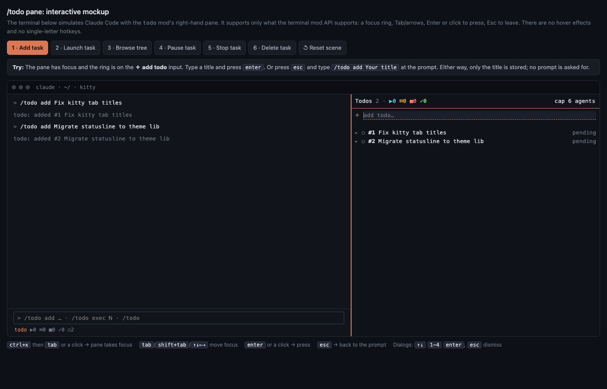
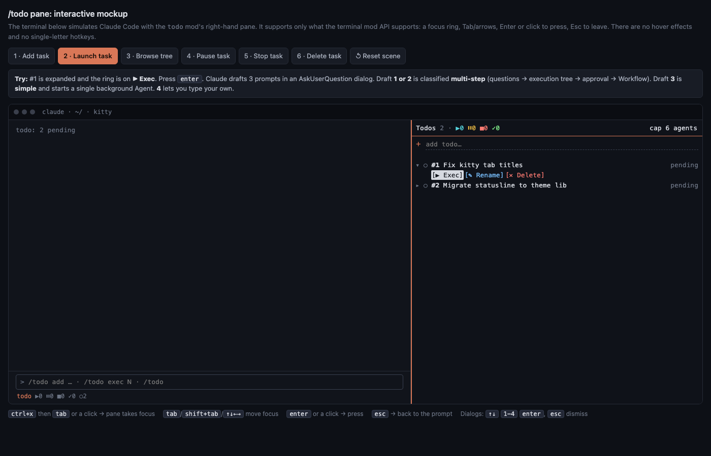
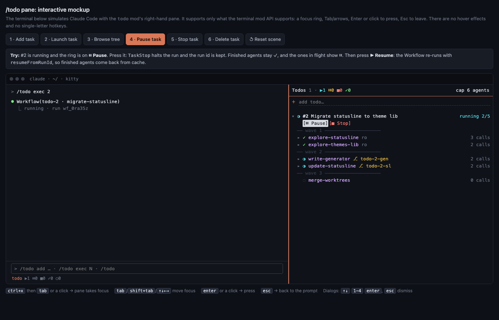
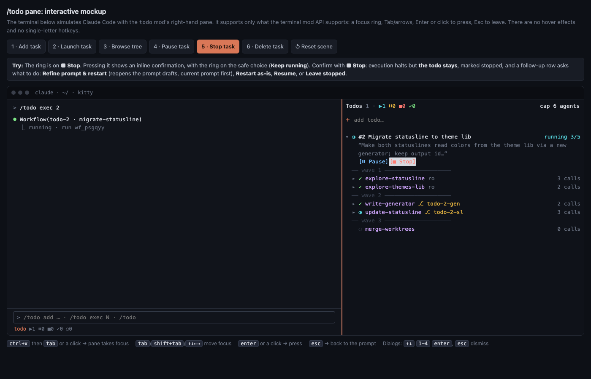
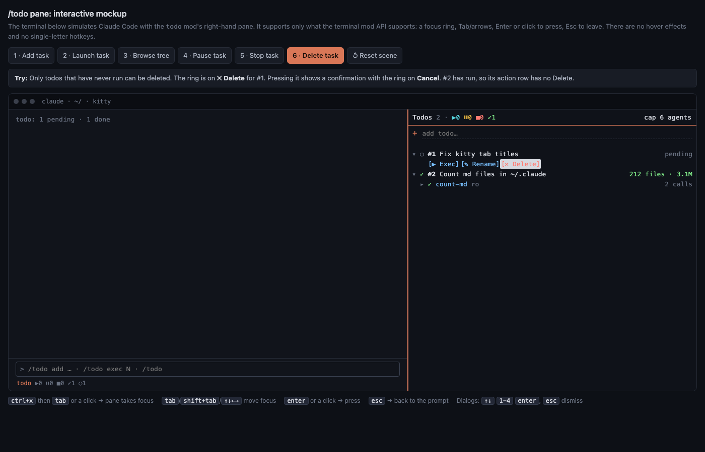
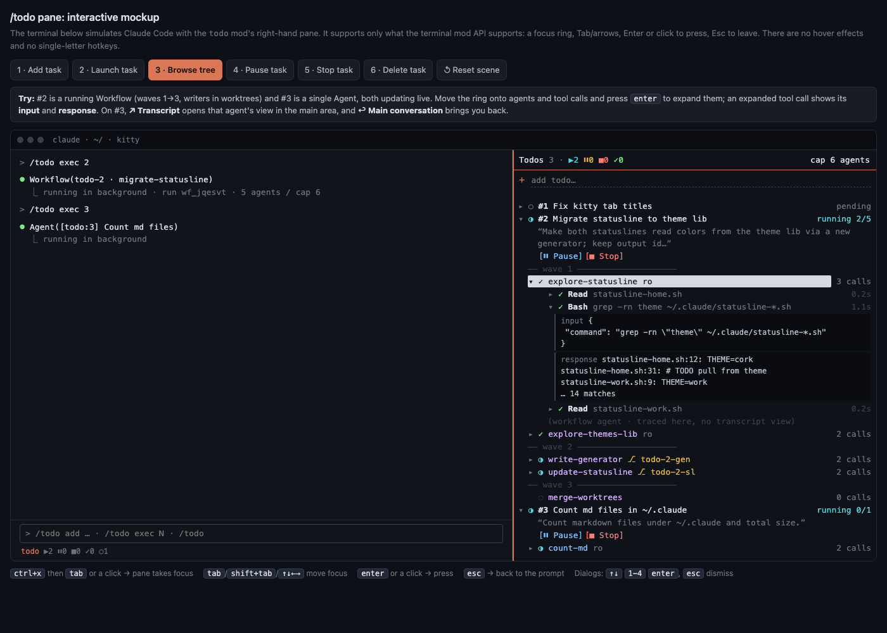

# todo — a per-directory backlog for Claude Code that turns titles into subagent work

<table>
<tr><th align="left">Checks</th><td><a href="https://github.com/declanshanaghy/claude-todo/actions/workflows/ci.yml?query=branch%3Amain"></a> <a href="https://github.com/declanshanaghy/claude-todo/actions/workflows/ci.yml?query=branch%3Amain"></a> <a href="https://github.com/declanshanaghy/claude-todo/actions/workflows/ci.yml?query=branch%3Amain"></a></td></tr>
<tr><th align="left">Quality</th><td><a href="https://github.com/declanshanaghy/claude-todo/actions/workflows/ci.yml?query=branch%3Amain"></a> <a href="https://github.com/declanshanaghy/claude-todo/blob/main/docs/test-cases.md"></a> <a href="https://github.com/declanshanaghy/claude-todo/blob/main/package-lock.json"></a></td></tr>
<tr><th align="left">Activity</th><td><a href="https://github.com/declanshanaghy/claude-todo/commits/main"></a> <a href="https://github.com/declanshanaghy/claude-todo/commits/main"></a> <a href="https://github.com/declanshanaghy/claude-todo/issues"></a></td></tr>
<tr><th align="left">Versions</th><td><a href="https://github.com/declanshanaghy/claude-todo/blob/main/.claude-plugin/plugin.json"></a> <a href="https://github.com/declanshanaghy/claude-todo/blob/main/.github/workflows/ci.yml"></a> <a href="https://github.com/declanshanaghy/claude-todo/blob/main/LICENSE"></a></td></tr>
</table>

Jot a todo down with just a title. Later, `exec` it: Claude drafts prompts for you to pick from, judges how big the job is, and either fires one background subagent or plans with you and runs a Workflow, a dependency tree of subagents, with parallel writers isolated in git worktrees. A right-hand pane shows everything live and lets you control it: launch, pause, resume, stop, refine, delete, and drill into every agent's tool calls and responses.

## Install

```
/plugin marketplace add declanshanaghy/claude-todo
/plugin install todo@claude-todo
```

Or declare it in your settings so every machine picks it up:

```json
{
  "extraKnownMarketplaces": { "claude-todo": { "source": { "source": "github", "repo": "declanshanaghy/claude-todo" } } },
  "enabledPlugins": { "todo@claude-todo": true }
}
```

## Use

| You | What happens |
|---|---|
| `/todo add Fix kitty tab titles`, or type in the pane's **＋ add todo…** | The todo is stored with its title only, at once; a small background subagent then drafts 3 candidate prompts for it. Meanwhile it is ◔ prompting and nothing starts it; then it turns ○ pending and its open row says "3 drafts ready" |
| `/todo exec 1` (or a title fragment), or **▶ Exec** in the pane | Claude asks for the prompt, offering the stored drafts straight away (or drafting 2–3 if there are none; type your own via Other), then classifies it |
| `/todo exec auto 1` (or `/todo exec 1 auto`), or **⚡ Auto** in the pane | The same run with no questions: Claude takes the best draft (or writes the one prompt it would have offered first), and plans multi-step work on its own best-effort defaults, launching without plan-mode approval |
| `/todo exec auto`, or **🔥 Fire** in the pane's header | Auto-runs the next todo in line, the lowest-numbered pending one (skipping any still prompting), or says none is pending |
| `/todo auto 1`, or bare `/todo auto` | Short for `/todo exec auto 1` and `/todo exec auto`, the commands you reach for most |
| `/todo resume 1` (or a title fragment) | What **⏵ Resume** does, typed, so a paused or stopped todo can be picked up without the pane. It takes exactly the todos the chip is offered on; for any other it answers in one line with the todo's status and the command that does apply (`#3 is pending: /todo exec 3`). A todo paused before it ever ran has no run to pick up, so it starts as an exec would |
| simple | One background Agent |
| multi-step | Plan mode → questions until the subtasks are clear → an execution tree for you to approve → Workflow |
| **⏸ Pause** / **⏵ Resume** | Stops the task; resuming wakes it (a Workflow replays its finished agents from cache, a lone Agent is sent a message to continue), or, when it can't be woken, starts a fresh agent on the worktree and record it left |
| **■ Stop** | Confirms, stops, and keeps the todo, then offers **✨ Refine** (pick a new prompt, then restart), **↻ Restart** (same prompt), **⏵ Resume** or **✓ Leave** |
| **✕ Delete** | Confirms, then removes the todo; only offered for todos that have never run |
| `/todo show` (or bare `/todo`, `/todo list`) | Opens and focuses the pane, or tells you why it can't be placed |
| `/todo noshow` | Closes the pane and keeps it closed for the rest of the session, until `/todo show` |


*Adding: `/todo add` and the pane's input both store just a title.*


*Launching: ▶ Exec hands the todo to Claude, which offers its drafted prompts and asks you to pick one.*


*Pausing: TaskStop halts the run but keeps its run id, so ⏵ Resume picks up from cache.*


*Stopping: an inline confirmation starts on the safe choice; the todo stays, with follow-up options.*


*Deleting: only never-run todos can be deleted, again behind a confirmation.*

Open [docs/mockup.html](docs/mockup.html) in a browser for an interactive walkthrough of every flow (`#m1`–`#m6` jump to a scene). The mockup sketches layout and flow; the live pane uses the styling described below.

## The pane

The pane opens on the right at session start and keeps the tree short, then lets you drill down one level at a time:

| Level | Press | What opens |
|---|---|---|
| 0 | — | Each todo is one line, `▸ #N title ──── ▶ 2/5`: its number and title in its status color, a dim rule, and its status's mark (with subtasks done out of all) at the right, in the same symbol and color as the counts, so a glance down the right edge reads the backlog's state. The word stays the line's label for screen readers. It never wraps: the title is cut with … first, sized in terminal cells so a wide emoji can't overflow it |
| 1 | the todo's line | Its prompt in two lines, a ✓ summary once done, the action chips, and `▸ N subtasks · d done · c calls` |
| 2 | the subtasks line | One row per subtask (an agent), grouped by wave for a Workflow, worktree writers marked ⎇, with its call count |
| 3 | a subtask | Its last 6 turns and tool calls, one line each, and **↗ Full transcript** |

The header line is its own splitter, so a closed todo costs one row and the rule that keeps a long tree's todos apart is the same line you press; there is no separate row or divider to keep in step with it. Each level stays a glance (two lines of prompt, six lines of activity) so opening one never pushes the rest of the backlog off the pane, and closing a level closes everything under it, so reopening starts folded. What's open is kept with the pane's other UI state, across redraws and reloads. The detail lives in a dialog: **↗ Full transcript** turns the pane into a browser of that agent's work, read like Claude Code's own transcript: what the agent wrote between its tool calls, then each call with its formatted input and its ⎿ result; **☰ Details** on a todo shows its full prompt, run ids and agents. `esc` closes the dialog and puts the ring back on the subtask's row.


*Browsing: open a todo, its subtasks and one subtask to see its latest calls; ↗ Full transcript reads everything it wrote and every tool call it made.*

- **Keys.** `ctrl+x tab` (or a click) moves the keys into the pane, `tab`/arrows move the focus ring (even when the tree is taller than the pane, which scrolls to keep the focused item in view; a trackpad swipe scrolls), `enter` presses, `esc` returns to the prompt. Confirmations put the ring on the safe choice first.
- **Focus.** While the pane holds the keys, Claude Code's own focus ring (the inverted element) sits on the selected item, so that is where your typing goes. Inversion alone is hard to see, so whatever holds the ring (the add input, a todo or agent row, an action chip, the rename input) also gets an orange `[ ]` in the cell on either side; every other item keeps those cells blank. Focus never moves anything or adds a line, and the pane has no blank lines: every item is one line, and a todo's actions are always one row. The background is transparent, so your terminal's own shows through.
- **Dialog.** The arrows (or a trackpad swipe) scroll it, and `esc` (or clicking elsewhere) closes it and puts the focus ring back where you were (the subtask row for a transcript, the chip for Details), keeping the keys in the pane. It replaces the tree in the same pane rather than opening a second one, because a pane can't take the keyboard from another pane, and that would cost a second `esc`. The agent's own text and any response that reads as markdown (headings, lists, tables, fences) are drawn the way the chat draws a reply; commands read as bash, file bodies are highlighted by their file type, an `Edit` shows as a diff and JSON is pretty-printed. A picture a call read or returned shows as a small thumbnail in the terminal, and as its name and size elsewhere.
- **Folding.** A long block shows its first few lines and a **… +N lines** toggle. The toggles are the dialog's only presses, so they work like every other focusable item: `tab` walks them, `enter` flips one, and the ring's border shows which. A mode key would have needed keys a pane never receives, and the arrows already scroll. Only the newest 40 entries are drawn, with older ones a toggle away, and drawing stops short of the host's size limit for one drawing, so an agent with hundreds of calls stays quick to open.
- **Views.** The header's counts are also the list's filter: one toggle per status (▶ running, ◔ prompting, ○ pending, ✗ failed, ⏸ paused, ■ stopped, ✓ done), lit while its todos are shown, dimmed and struck through while hidden. By default the pane shows what's live or needs you (running, prompting, pending, failed), so finished and parked work stays out of the way without being deleted; press ✓ to bring done todos back, and they sort to the bottom so they never crowd out live work. **all** lights everything and then reads **default**, one press back to the usual view. Drafting and planning are the start of a run, so they go with ▶. A footer says how many todos the view hides, so nothing silently disappears, and the todo you're acting on (under the focus ring, or just stopped and asking what next) stays put even when its new status is hidden. The view is kept with the rest of the pane's layout, across reloads and sessions. The toggles come first in the focus ring, then 🔥 Fire, then the add input.
- **Counts.** Each toggle counts its status in the color its rows' glyph uses (a running row spins Claude's spinner instead of ▶), always over the whole list, whatever the view hides. While the pane isn't on screen (closed, `/todo noshow`, waiting for a wider terminal, or covered by the dialog) the same marks move to the mod's status line under the prompt, so the counts show in exactly one place. A status line takes plain text only, so there they're uncolored. Every status's symbol and color is defined once, in `hooks/marks.tsx`, along with the glyph, chip and summary widgets that draw them, so the rows, header, status line, toasts and buttons can't drift apart.
- **Buttons.** A chip draws only its symbol, so an action row fits a narrow pane; its word is still its accessible label, and a confirmation's sentence says what its symbol will do. ▶ Exec · ⚡ Auto · 🔥 Fire · ✎ Rename · ✨ Refine · ↻ Restart · ⏵ Resume · ⏸ Pause · ■ Stop · ✕ Delete · ⇄ Takeover · ☰ Details · ↺ Reset · ↩ Keep/Cancel/Back · ✓ Leave · ↗ Full transcript.
- **Session title.** When the session has a title, the header's right end shows it in the prompt bar's border color, so the pane says which session it belongs to just as the prompt does. The engine's pane frame takes only a plain tab label, drawn only while several panes are open, so the title sits in the header row instead. A mod can't ask for the title directly, so the pane picks it up from the session-start and prompt events, which carry it: a `/rename` shows from your next prompt on, and a title another hook sets wins.
- **Look.** Rows borrow Claude Code's transcript style so the pane reads like the chat beside it: Claude's spinner (· ✢ ✳ ✶ ✻ ✽) on running work, `⏺ Tool` rows in the dialog that are green, red or yellow for success, error or interrupted, and filled chips for the action buttons, each filled with the color of the status it moves the todo into, so a button reads like the row it will produce: ▶ Exec, ⚡ Auto and ⏵ Resume green like a running row, ⏸ Pause yellow like a paused one, ■ Stop red like a stopped one, ✨ Refine and ↻ Restart blue like a drafting one. Done is purple, so a finished row never looks like a running one. ✕ Delete is red as well, and actions that change no status (✎ Rename, ↺ Reset, ☰ Details, ↩ Keep/Cancel) are a neutral grey. The rule in each todo's line is sized to the pane's width, so it never wraps. Every color is a theme key, so the pane follows `/theme`.

## Settings

| Setting | Default | What it does |
|---|---|---|
| **Done todo lifetime (minutes)**: `doneTtlMinutes` in `/config`, or the `CLAUDE_TODO_DONE_TTL_MINUTES` environment variable, which wins | 5 | How long a done todo stays in the tree after it finishes. `0` keeps them. Hidden todos stay in the database and in `mcp__todo__list`; a failed todo is never hidden. |

A dev copy loaded with `--plugin-dir` gets no `/config` row, so use the environment variable there.

Earlier versions had a **Todo dividers** setting for a rule above each todo; each todo's line now carries its own rule, so the setting is gone, and a value still in `/config` or `CLAUDE_TODO_DIVIDERS` is ignored.

## Troubleshooting

- **Pane not visible.** Run `/todo show`. It always places the pane when asked and, if it can't, says why. If you ran `/todo noshow` earlier, the pane stays closed until you do.
- **Narrow terminal or fullscreen TUI.** At session start the pane only seats itself when there's room; widen the terminal or use `/todo show`, which places it at any width.
- **Todos from another session missing.** A list belongs to the git repo the session is in (any subdirectory of it), or to your home directory outside a repo. A linked worktree is its own repo, so it has its own list.
- **⚠ sqlite3 was not found.** The mod drives the `sqlite3` command-line tool (macOS ships it; on Linux install your distribution's `sqlite3` package). Until it's found, the pane is read-only and an older session's todos stay where they were.
- **A todo is running in another session.** Only the session that launched it can pause or resume it. If that session is gone, **⇄ Takeover** marks the todo stopped here so you can restart it; it doesn't stop a run that is still going there.
- **Two copies loaded.** Don't run the installed `todo@claude-todo` and a dev copy in the same session: both register the same `/todo` command, `mcp__todo__*` tools and pane, and they fight over them. Disable one first.

## How it works

[Architecture](docs/architecture.md) has the diagrams: how the pieces fit, where state lives, how writes from parallel sessions stay safe, how a todo runs, and how parallel todos land.

- **Scope.** Todos belong to a directory: the repo the session is in, else your home directory. Every session there, now or later, shares one list. If a session moves to another repo (`/cd`, a worktree move), the pane switches to that repo's list.
- **Storage.** Todos, their agents, and every tool call those agents made (input, response, timing, outcome, and the session that recorded it) live in one SQLite file in Claude Code's plugin data folder. It's shared by every session and by both the installed and a dev copy of the mod, so a restarted session can still browse past runs. The mod drives it through the `sqlite3` CLI (see `hooks/db.ts`). A todo write names the list revision it was based on. If another session changed the list in between, the write is refused inside the same transaction, and the mod re-reads and applies the change again, so no edit is lost. The pane re-reads only when the file changes.
- **Ownership.** A todo in flight (drafting, planning, running, paused) belongs to the session that launched it. Other sessions show it, won't pause or resume it (its task ids aren't theirs), and offer **⇄ Takeover** instead. Nothing is taken over automatically, so a session waking from sleep keeps its work.
- **Upgrading from 0.2.** Earlier versions kept todos in session state, which ends with the session, so only sessions still open can be moved. Reload them once 0.3 is installed. On its first start, each one moves its todos into the directory's list, in one transaction with a backup row and a run-once marker, so a retry never adds them twice. Never-run todos whose title the list already has are merged into that todo. Others keep their number unless it's taken, and the pane follows any renumbering. Its agents and calls are written out too. Only after the import commits is the old copy cleared. The backup is deleted at the next start.
- **🔥 Fire.** Working down the backlog shouldn't mean opening each todo, so the header carries one press that does what `/todo exec auto` does: it takes the next todo in line and runs it in auto mode, through the same path as the command, so the two can't disagree about which todo is next. It wears the running color, like ▶ Exec and ⚡ Auto, as that's where it puts the todo. While nothing is pending, or the agents already running fill the cap, it dims instead of hiding, so the header doesn't jump about and the arrow keys still reach it; pressing it then says why rather than queueing work the cap would only hold back.
- **Auto mode.** Asking is the safe default: a title is often too thin to act on, and a wrong guess costs a whole run. Auto is for todos whose title already says enough, or for working down the backlog unattended. The protocol only drops the questions; the prompt it settles on is recorded as usual and multi-step plans list the defaults Claude chose, so a run that went the wrong way shows why, and ✨ Refine or ↻ Restart picks it up from there.
- **Model-driven, mod-tracked.** The mod never plans or launches a todo's work itself (its only own agent is the prompt drafter below). `exec`, *refine*, *restart* and *resume* submit a short protocol prompt (see `hooks/protocol.ts`), and Claude does the asking, planning and launching. Claude reports progress through the mod's `mcp__todo__update` tool and can read the backlog with `mcp__todo__list`; both answer in plain text, like any MCP tool.
- **Prompt drafts.** Drafting prompts is the slow part of ▶ Exec, and it needs nothing from you, so it happens ahead of time: the moment a todo is added, the mod spawns one drafting subagent itself. It's its own agent type, hidden from the model's agent list, on a small model and allowed only to read (Read, Grep, Glob); its drafts come back as its final answer, a small JSON object the mod reads as the drafter ends (a tool call from a background drafter never reached the mod). Adding never waits for it. Its 3 drafts are kept on the todo, apart from the prompt you pick, so ▶ Exec asks its one question at once and ⚡ Auto takes the first. A rename makes them stale: they're cleared and drafted again, and late drafts for the old title are refused by the key each launch hands its drafter. While the drafter works the todo is ◔ prompting, a status of its own, so every session sees it isn't ready: ▶ Exec and ⚡ Auto are dimmed, and they, `/todo exec` and 🔥 Fire refuse it (Fire moves on to the next pending todo) rather than drafting twice or holding an exec in the background. Its drafts turn it ○ pending. If the drafter ends without drafts or can't start, it turns pending anyway and Claude drafts in the chat as before; one whose drafter was lost (a `/clear`, a restart, a session gone) is handed back at the next sync, at once in its own session and after 2 minutes in any other. The drafter is tagged `[todo-drafts:N]`, never `[todo:N]`, so it never shows as the todo's run or moves its status.
- **Linking.** A todo's Agent is tagged `[todo:N]` and its Workflow is named `todo-N-…`. The mod hooks `tool.call` and `agent.spawn` to tie every spawned agent (nested ones through their parent) back to the todo, and then records each of those agents' tool calls with an input and response preview. It also hooks `turn.step`, the model's response to each request, to keep the text an agent writes between its calls. Those turns sit in the calls table beside the calls, so they page, expire and are deleted with them, and survive a restart the same way; the dialog orders the two by when each began.
- **Pictures.** The database never holds an image's bytes, only where to find them: the file a `Read` named, or, for an image a tool returned, a sidecar file its data was written to beside the database. The thumbnail is made only when the dialog first shows it: a PNG is drawn straight from its file, anything else is scaled into a small PNG first (with `sips` on macOS, else ImageMagick). A picture whose file is gone or can't be read keeps its name and size in its place.
- **Control.** Pause and stop call `TaskStop` directly. Resume asks Claude to wake the work first: re-run the Workflow with `resumeFromRunId`, or `SendMessage` the stopped agent. That works after the pane's own Pause or Stop, but Claude Code won't wake an agent you stopped yourself (from its tasks list or an interrupt), a Workflow run only resumes in the session that started it, and a taken-over todo's agent was another session's. In those cases Resume starts a fresh agent instead, in the worktree the old one kept (found by its agent id in `git worktree list`), briefed with the todo's prompt, that branch's commits and diff, and the turns and calls already recorded, so nothing it did is lost. A Workflow's interrupted writers' branches are merged in too. The todo shows as in the chat's hands until Claude reports it running, and goes back to how it was if nothing could start.
- **Parallelism.** Every todo works on its own branch in its own git worktree, never in your checkout, and commits as it goes; a Workflow's writers each get one, and its merge agent combines them. The total agents per todo is capped at CPU count − 4.
- **Landing.** Once the project's own checks pass (what its README, scripts or CI run), the todo squashes its branch into one commit, rebases it onto the base branch on `origin` (the branch your checkout was on when it started), runs every check again on that commit, and pushes it there. So the base gets one self-contained commit per todo that passes on its own, which keeps `git bisect` and `git log` useful. Its message says what changed and why, lists the checks it passed and names the todo (`Todo: #N`). Your checkout isn't touched: pull to pick the work up. Uncommitted changes in your checkout aren't seen by a todo, and Claude says so when it starts one. A todo is done only once it landed; its worktree and branch are then removed, and **Details** shows the branch and the pushed commit.
- **Parallel todos.** They meet at the push. A rejected push means another todo landed first, so the later one fetches, rebases and resolves the conflicts keeping both changes, runs the checks again and retries. It never force-pushes. A conflict it can't resolve with confidence aborts the rebase and fails the todo, naming the files and keeping the branch for you.

## Developing

- **Types first.** Lint and typecheck read the API declarations Claude Code writes into the mod's folder when an interactive session loads it with `claude --plugin-dir .`. Start one once, and again after updating Claude Code, before running them. A `-p` session, `validate` and `test` don't write them.
- **Checks.** After `npm ci`: `npm run lint`, `npm run typecheck`, `claude plugin validate .`, `claude plugin test .` and `npm run coverage`, which recounts the test-cases table and fails if the ratio it states at its top is wrong or under 95%. The TypeScript and ESLint configs turn on every strictness option and typescript-eslint's strict, type-checked sets. Each rule that's tuned or off has its reason beside it in the config.
- **Tests.** `claude plugin test` runs them in a sandbox with no processes or files, so the test file's `engine()` stands in for the host. It includes an in-memory SQLite that answers each script from its `-- op` header, plus hooks for a test to fail a write or move another session's revision between a read and a write. [docs/test-cases.md](docs/test-cases.md) lists every behaviour worth testing and the test that covers it.
- **CI.** Every push and pull request runs those five checks, each as its own job so each passes or fails on its own, against a pinned Claude Code version (bump it in the workflow alongside your own). To get the declarations, CI starts an interactive session under a pseudo-terminal, with onboarding done, the checkout trusted and a placeholder API key. The mod loads before anything would be sent, so no secret is needed.
- **Badges.** The table at the top is all live, at most three badges a row, picked to show the repo's health at a glance; each links to where its value comes from. The tests tally, coverage gate, CI pass rate, behaviour coverage and `npm audit` aren't things shields.io can see, so the Badges workflow computes them: after every CI run, and daily so new advisories show, it asks the GitHub API (with only its own token) about CI's recent runs on `main`, recounts the test-cases table, audits the checkout, and commits the results as shields.io endpoint files to the `badges` branch, dropping any file no badge reads. The rest are read by shields.io straight from GitHub and the manifests on `main`, so bumping the plugin's or the pinned Claude Code's version shows up without touching the README. A new computed badge needs its file produced by that workflow and kept by its cleanup.

## License

MIT
