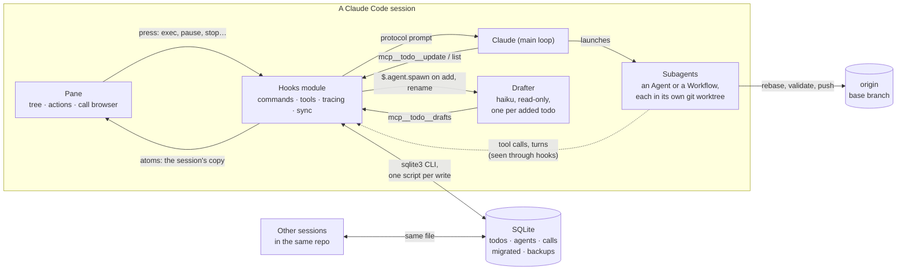
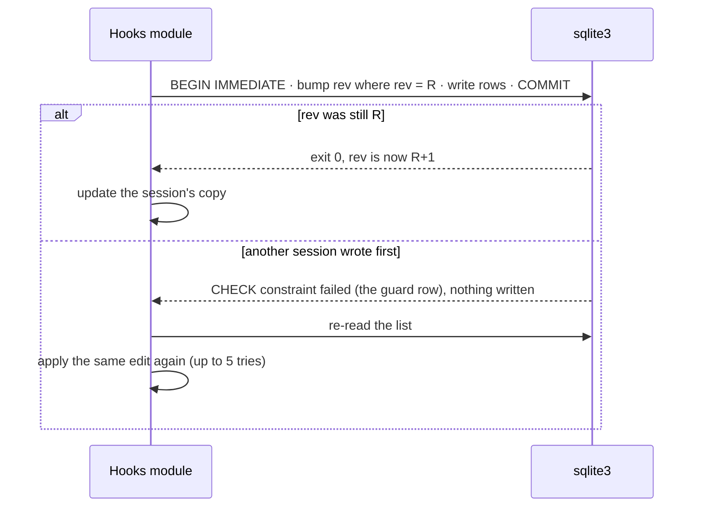
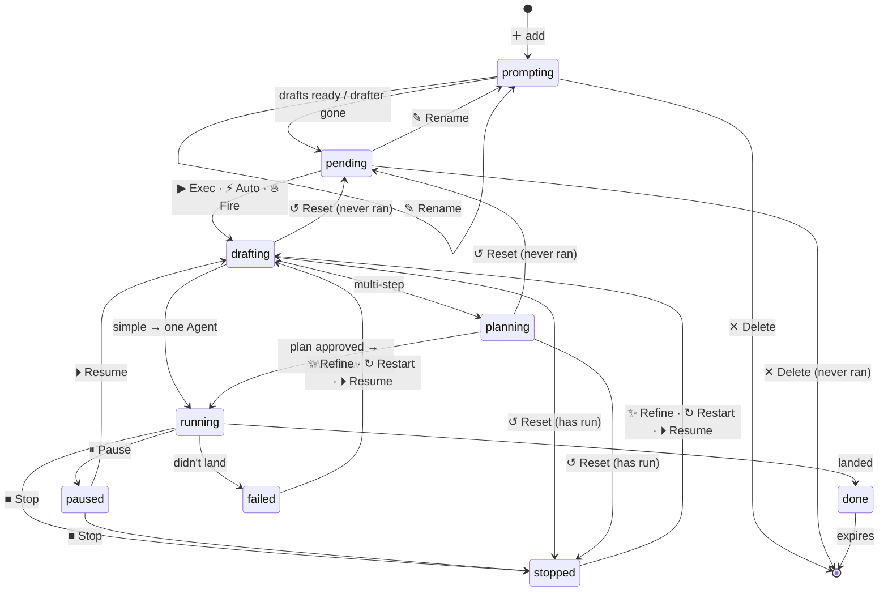
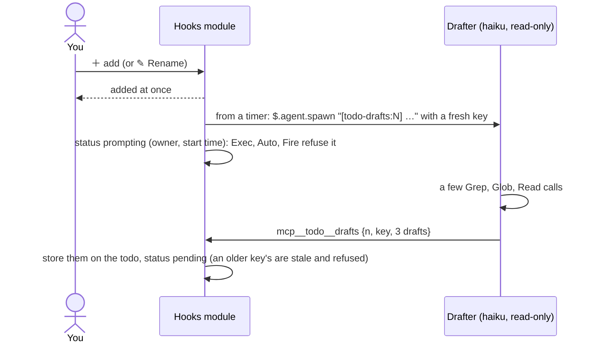
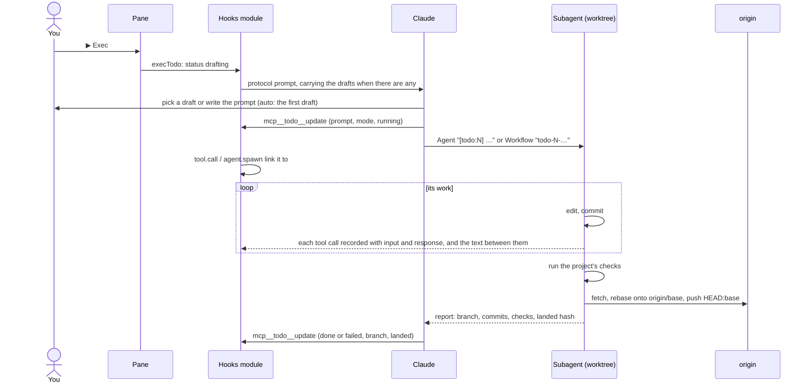
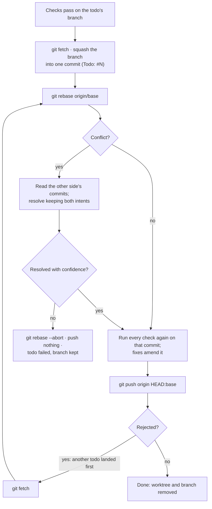

# Architecture

The mod is a hooks module that runs inside every Claude Code session. It never plans or launches a todo's work itself: it keeps the backlog, draws the pane, and hands Claude a protocol prompt. Its one agent of its own is a small, read-only drafter it spawns when a todo is added, so the prompts are ready before you press ▶ Exec. Claude asks, plans and launches subagents. The mod watches what gets launched and records it in a database that every session shares.

## The pieces

| Piece | Role | Source |
|---|---|---|
| Hooks module | Registers `/todo`, the `mcp__todo__*` tools, the drafter's agent type and the pane; spawns a drafter for each added or renamed todo; links launched agents to their todo; records every tool call and the text its agents write between them; keeps the session's copy of the list in sync | `hooks/register.tsx` |
| Database layer | Builds each SQL script, runs it through `sqlite3`, parses the answer | `hooks/db.ts` |
| Pane and call browser | Draw the tree, the action chips and the read-only dialog from the session's copy | `hooks/pane.tsx`, `hooks/detail.tsx` |
| Protocol | The prompts Claude follows for exec, restart and resume, including the git rules, and the drafter's task | `hooks/protocol.ts` |
| Contract | The todo, agent and call shapes, and the state the pane reads | `types/index.d.ts` |

## Where state lives

| State | Where | Why there |
|---|---|---|
| Todos, agents, tool calls and turns | One SQLite file in Claude Code's plugin data folder, keyed by directory | Shared by every session and every copy of the mod; survives restarts |
| The session's copy of its directory's rows | `$.state` atoms | The pane draws from them, and a write to one redraws it |
| Pane layout (open rows, confirmations, focus ring, the view) | `$.state` atoms | Per session; nothing else needs it. What's open and the view outlast a reload |
| A todo's drafts | On the todo's row, beside (never in) its chosen prompt | Ready for any session's ▶ Exec, and kept through restarts |
| Drafters in flight and their keys | `$.state` atoms | A drafter belongs to the session that spawned it; the todo's `prompting` status (with its owner and start time) is what other sessions see |
| Settings | `/config` (`pluginConfigs`) or environment variables | Claude Code's standard plugin options |

A list belongs to the git repo the session is in (each worktree is its own repo), or to the home directory outside one. If a session moves to another repo (`/cd`, a worktree move), the next sync loads that repo's list. A `/clear` or `/new` carries on under a new session id with the session's state reset and no `session.start`, so the mod sets itself up again at that `SessionStart` (and at any sync tick that finds no database handle), and the repo's list comes back from the database. Its todos stay its own: `session.end` notes the ending session id, and that boot takes over the todos it owned. A todo paused before it ever ran has no run to take, so it belongs to no session.

## Writing without losing edits

`sqlite3` runs one script per process, so a transaction can't stay open while the mod's own logic runs. Instead, each write says which revision of the list it was computed from:

Agents, calls and turns (an agent's text between calls, kept as rows of the calls table) are written through as they change: they're keyed by id and only ever written by the session that recorded them, so they need no revision check. Every two seconds the session re-reads when the database file's modification times change, picking up new calls by sequence number.

A failed run (most often a write the host aborts as the turn it served ends) is reported once and doesn't stop the next write. Only a missing `sqlite3` or data folder makes the pane read-only.

## A todo's life

A todo is always in one of nine states. `MARK` in `hooks/marks.tsx` gives each one its symbol and color, and every button is filled with the color of the state it leads to, so a button's color tells you where it takes the todo. ▶ Exec, ⚡ Auto, 🔥 Fire and ⏵ Resume launch a run, so they wear running's green although the todo passes through drafting on the way; ✨ Refine and ↻ Restart wear drafting's blue, as they draft it again. Buttons that change no status (✎ Rename, ☰ Details, ✓ Leave, ↩) and ↺ Reset, which only hands the todo back, are neutral grey. While a todo is prompting, ▶ Exec and ⚡ Auto stay in its row but dimmed: a press says its prompts are still being drafted.

Edges are labeled with the button that takes them; ■ Stop and ✕ Delete ask first. A todo is prompting from the moment its drafter is spawned (an add, or a rename that changed its title) until the drafts are stored; it falls back to pending when the drafter ends without drafts, can't be spawned (then it never leaves pending), or isn't running in any session: the next sync tick hands back one this session prompts whose drafter it no longer tracks (a `/clear` or a restart lost it), and another session's after 2 minutes. A dismissed prompt question acts like ↺ Reset, an agent stopped outside the pane acts like ■ Stop, and `/todo exec` (with or without `auto`) is ▶ Exec or ⚡ Auto typed, which also starts a stopped or failed todo again, never a prompting one (`/todo auto` is short for `/todo exec auto`). `/todo resume` is ⏵ Resume typed, for the same todos; a todo paused before it ever ran starts as ▶ Exec would.

| State | Mark | Meaning | Who moves it on |
|---|---|---|---|
| prompting | ◔ | Added (or renamed); its drafter is writing prompt drafts, so nothing may start it yet | The drafter's drafts or its end; the sync tick if it's gone |
| pending | ○ | Ready to run: never run (or run, then reset before it started again) | You |
| drafting | ✎ | Claude is writing or refining the prompt, or resuming | Claude, via `mcp__todo__update` |
| planning | ◇ | Multi-step: plan-mode questions and the execution tree | Claude |
| running | ▶ (spins) | An Agent or Workflow is working | The agent's end |
| paused | ⏸ | Halted with its run kept, so Resume picks up where it was | You |
| stopped | ■ | Halted for good; its worktree and branch are kept | You |
| done | ✓ | Landed (or committed, with no remote) | Expires after the keep period |
| failed | ✗ | Finished without landing; its worktree and branch are kept | You |

`drafting` and `planning` belong to the chat: the todo leaves them only when Claude reports, or when you press Reset.

### Buttons by state

Each button is filled with the color of the state it leads to (the launchers in running's, as above). Destructive buttons ask first, with the ring on the safe choice. A test ("each state draws exactly the chips docs/architecture.md lists for it") draws every row below and presses every button, so this table and the pane can't drift.

| State | Buttons | Leads to |
|---|---|---|
| prompting | ▶ Exec and ⚡ Auto dimmed · ✎ Rename · ✕ Delete · ☰ Details, and the hint "no prompt yet: drafting prompts…" | refused, saying why · refused · prompting under a new drafter · confirm → removed · call browser |
| pending | ▶ Exec · ⚡ Auto · ✎ Rename · ✕ Delete (only if it never ran) · ☰ Details, and a hint once its drafts are stored: "3 drafts ready" | drafting · drafting · prompting · confirm → removed · call browser |
| drafting / planning | ↺ Reset (and a hint: "answer the prompt question in the chat…", "continuing in the chat…" once it has run, "planning in the chat…") | pending if it never ran, else stopped |
| running | ⏸ Pause · ■ Stop · ☰ Details | paused · confirm → stopped · call browser |
| paused | ⏵ Resume · ■ Stop · ☰ Details | drafting · confirm → stopped · call browser |
| stopped / failed | ⏵ Resume (if there's an agent or worktree to pick up) · ✨ Refine · ↻ Restart · ✓ Leave (right after a Stop) · ☰ Details, all on one row | drafting · drafting · drafting · collapses it · call browser |
| done | ☰ Details | call browser |
| in flight in another session | ⇄ Takeover · ☰ Details | confirm → stopped here · call browser |

The confirmations:

| Confirm for | Buttons |
|---|---|
| Stop | ■ Stop · ↩ Keep (back to running or paused) |
| Delete | ✕ Delete · ↩ Cancel (back to pending or prompting) |
| Takeover | ⇄ Takeover · ↩ Cancel (left in flight there) |

Pane-wide controls:

| Control | Where | Does |
|---|---|---|
| ＋ add todo… | top of the list | adds a pending todo |
| 🔥 Fire | header | `/todo exec auto` on the lowest-numbered pending todo (prompting ones are skipped); dimmed while none is pending or the agent cap is full |
| ↗ Full transcript | under an open subtask's latest calls | opens the call browser; Esc returns to the subtask |
| status toggles `▶ ◔ ○ ✗ ⏸ ■ ✓` · all | header, before 🔥 Fire | each shows or hides its state's todos (drafting and planning go with ▶ running), drawn as its mark and count, dimmed and struck through while hidden. The default view is running, prompting, pending and failed (a view stored before prompting had a toggle shows it wherever it showed pending); done sorts last when shown. `all` lights every one and reads `default` while they all are, pressing it then restores the default. A footer counts what the view hides. The todo the ring is on, and one just stopped, stay in the list whatever the view. The view is kept with the pane's layout; the counts and the status line always count the whole list |

## Running a todo

Drafting starts when the todo is added, so ▶ Exec has its prompts ready. Until they are, the todo is prompting and nothing starts it:

Without drafts (the drafter ended with none, couldn't start, or was lost), the protocol has Claude draft 2–3 prompts in the chat. Drafts that arrive after the todo started are kept but change nothing. The drafter's tag is `[todo-drafts:N]`, which the linking hooks skip, so it never becomes the todo's run.

A dropped prompt (the host refusing it, a Stop standing) puts the todo back where it was and says why. An agent stopped outside the pane ends with an aborted turn, which marks its todo stopped and its agent as one that can't be woken. ⏵ Resume then has Claude start a fresh agent in the worktree the old one kept, briefed with its branch and the turns and calls already recorded; it does the same when a Workflow run belongs to another session, or after a takeover.

## Parallel todos meet at the push

Each todo works on its own branch and never touches your checkout. Two todos that change the same files only meet when the second one lands:

Nothing ever force-pushes. Each todo lands as exactly one commit that passed every check on its own, so the base branch's history stays bisectable: work-in-progress commits stay on the todo's branch. In a Workflow, the writers each commit on their own branch and only the final merge agent squashes and lands.

## Upgrading from 0.2

0.2 kept each session's todos in that session's state. At its first start under 0.3, a session moves its todos into the directory's list in one transaction, together with a backup row and a run-once marker, so a retry never adds them twice. Never-run duplicates merge, clashing numbers are renumbered, and the session's own agents and calls are written out under the new numbers. The backup is dropped at a later start.
