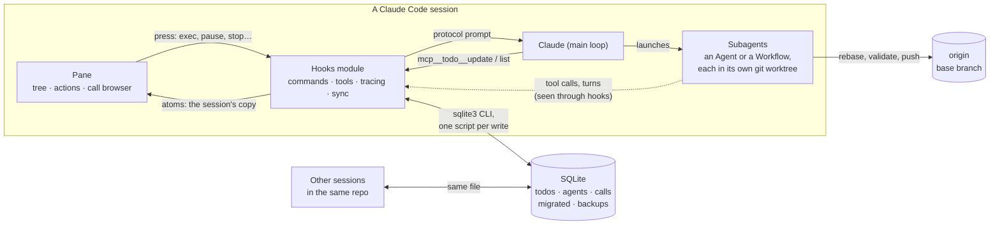
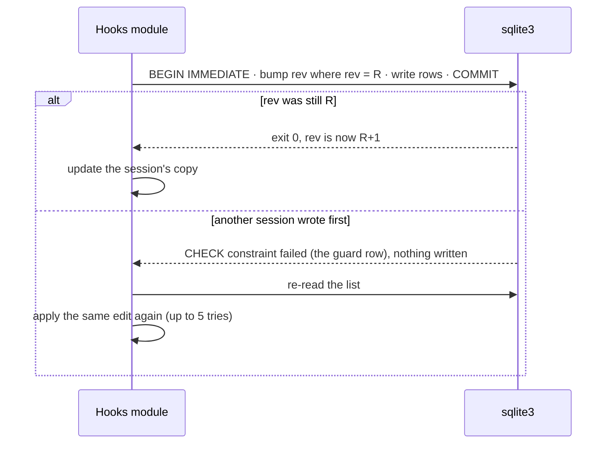
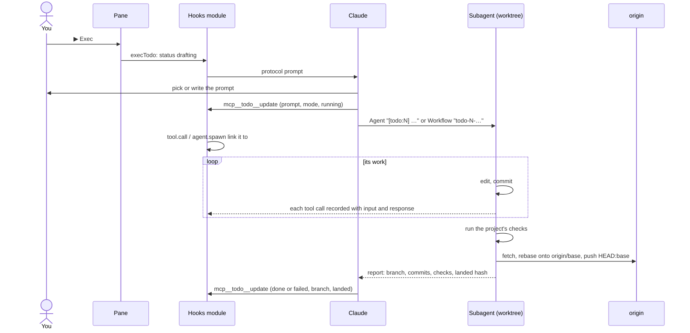
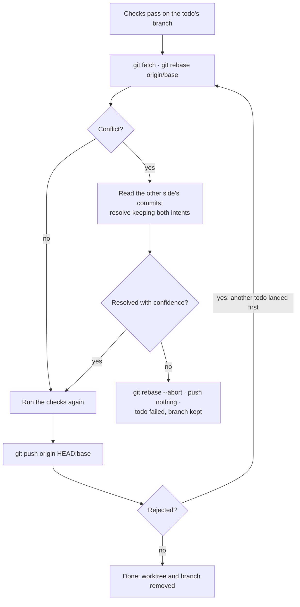

# Architecture

The mod is a hooks module that runs inside every Claude Code session. It never plans or launches work itself: it keeps the backlog, draws the pane, and hands Claude a protocol prompt. Claude asks, plans and launches subagents. The mod watches what gets launched and records it in a database that every session shares.

## The pieces

| Piece | Role | Source |
|---|---|---|
| Hooks module | Registers `/todo`, the `mcp__todo__*` tools and the pane; links launched agents to their todo; records every tool call; keeps the session's copy of the list in sync | `hooks/register.tsx` |
| Database layer | Builds each SQL script, runs it through `sqlite3`, parses the answer | `hooks/db.ts` |
| Pane and call browser | Draw the tree, the action chips and the read-only dialog from the session's copy | `hooks/pane.tsx`, `hooks/detail.tsx` |
| Protocol | The prompts Claude follows for exec, restart and resume, including the git rules | `hooks/protocol.ts` |
| Contract | The todo, agent and call shapes, and the state the pane reads | `types/index.d.ts` |

## Where state lives

| State | Where | Why there |
|---|---|---|
| Todos, agents, tool calls | One SQLite file in Claude Code's plugin data folder, keyed by directory | Shared by every session and every copy of the mod; survives restarts |
| The session's copy of its directory's rows | `$.state` atoms | The pane draws from them, and a write to one redraws it |
| Pane layout (open rows, confirmations, focus ring) | `$.state` atoms | Per session; nothing else needs it |
| Settings | `/config` (`pluginConfigs`) or environment variables | Claude Code's standard plugin options |

A list belongs to the git repo the session is in (each worktree is its own repo), or to the home directory outside one. If a session moves to another repo (`/cd`, a worktree move), the next sync loads that repo's list.

## Writing without losing edits

`sqlite3` runs one script per process, so a transaction can't stay open while the mod's own logic runs. Instead, each write says which revision of the list it was computed from:

Agents and calls are written through as they change: they're keyed by id and only ever written by the session that recorded them, so they need no revision check. Every two seconds the session re-reads when the database file's modification times change, picking up new calls by sequence number.

A failed run (most often a write the host aborts as the turn it served ends) is reported once and doesn't stop the next write. Only a missing `sqlite3` or data folder makes the pane read-only.

## Running a todo

A dropped prompt (the host refusing it, a Stop standing) puts the todo back where it was and says why. An agent stopped outside the pane ends with an aborted turn, which marks its todo stopped and keeps its id for ▶ Resume.

## Parallel todos meet at the push

Each todo works on its own branch and never touches your checkout. Two todos that change the same files only meet when the second one lands:

Nothing ever force-pushes. In a Workflow, the writers each commit on their own branch and only the final merge agent lands.

## Upgrading from 0.2

0.2 kept each session's todos in that session's state. At its first start under 0.3, a session moves its todos into the directory's list in one transaction, together with a backup row and a run-once marker, so a retry never adds them twice. Never-run duplicates merge, clashing numbers are renumbered, and the session's own agents and calls are written out under the new numbers. The backup is dropped at a later start.
